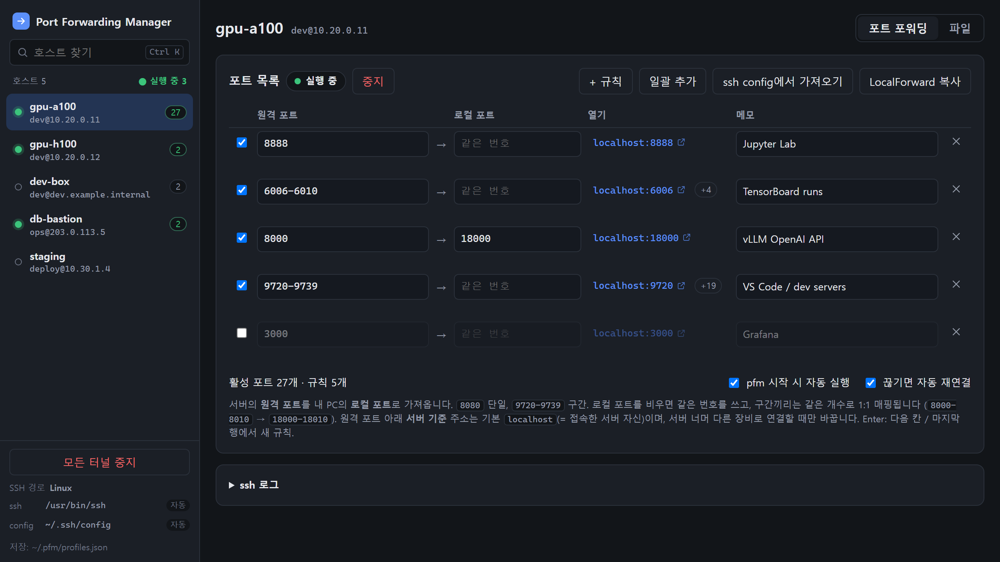
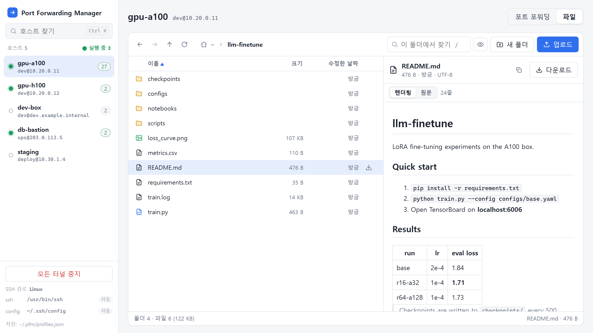

<div align="center">

# pfm · Port Forwarding Manager

**`~/.ssh/config`를 읽어 호스트별 SSH 포트 포워딩(`ssh -L`)과 원격 파일을 브라우저에서 관리하는 로컬 웹 UI**

Python 표준 라이브러리만 사용 · 설치할 것 없음 · Windows / macOS / Linux

</div>



## 빠른 시작

```bash
git clone https://github.com/ZeroAct/port-forwarding-manager.git
cd port-forwarding-manager
python pfm.py          # 브라우저가 http://127.0.0.1:8765/ 로 열립니다
```

- **필요한 것:** Python 3.10 이상, `ssh` 클라이언트, 키 기반 인증(ssh-agent 포함). 아직 키가 없으면 UI의 **키 등록**으로 만들 수 있습니다.
- 파일 브라우저를 쓰려면 서버에 `python3`가 있어야 합니다. 서버에 따로 설치할 것은 없습니다.
- `Ctrl+C`로 끄면 열려 있던 터널도 모두 함께 닫힙니다.

## 주요 기능

### 🔌 포트 포워딩
- **호스트 자동 인식:** `~/.ssh/config`의 호스트를 사이드바에 보여 줍니다. `Include`와 `Host *` 기본값도 반영합니다. 터널 상태와 포트 수가 함께 표시되고, `Ctrl+K`로 검색합니다.
- **표로 편집하는 규칙:** 한 줄에 규칙 하나씩, 원격 포트 → 로컬 포트 → 열기 → 메모 순서입니다. 고치면 바로 저장됩니다.
  - 단일 포트 `8080`, 구간 `9720-9739` (규칙 하나에 최대 1000개)
  - 로컬 포트를 비우면 원격과 같은 번호를 씁니다. 구간끼리는 1:1로 대응합니다(`8000-8010` → `18000-18010`).
  - 원격 포트 아래에 접혀 있는 **서버 기준 주소**는 기본값이 `localhost`(접속한 서버 자신)입니다. 서버 너머의 다른 장비(`db.internal` 등)로 연결할 때만 바꿉니다.
  - 일괄 추가: `9701, 9720-9739, 8080:80, 15432:db.internal:5432`
  - 겹치는 포트, 범위를 벗어난 값, 구간 길이가 다른 규칙은 그 줄에 바로 표시됩니다.
- **새 창으로 열기:** 규칙마다 `localhost:<포트>` 링크가 있습니다. 구간은 `+N`을 누르면 원하는 포트를 고를 수 있습니다.
- **자동 실행과 재연결:** pfm을 켜면 저장된 터널이 자동으로 시작되고, 끊기면 지수 백오프로 다시 연결합니다. 호스트별 체크박스나 `--no-autostart`로 끌 수 있습니다.
- **ssh config와 함께 쓰기:** 기존 `LocalForward` 줄을 구간으로 묶어 가져옵니다. 실행할 때는 config에 이미 있는 포워딩을 빼고 띄우므로 서로 겹치지 않습니다.
- **많은 포트도 안정적으로:** 포트 100개마다 ssh 프로세스를 하나씩 나눠 띄웁니다. Windows 기본 OpenSSH의 소켓 수 제한(약 256개)을 넘지 않기 위해서입니다.

### 📁 파일 브라우저



- **홈 디렉터리 안에서만:** 선택한 서버의 홈 아래만 열 수 있습니다. 서버에서 모든 경로를 `realpath`로 확인하므로 심볼릭 링크나 `..`로도 홈 밖에 닿을 수 없습니다.
- **미리보기:** 코드/텍스트(줄 번호, 줄바꿈), Markdown 렌더링, JSON 정렬, CSV/TSV 표, 이미지, 동영상/오디오(구간 이동 가능), PDF, 바이너리는 hex로 보여 줍니다.
- **다운로드:** 파일은 그대로, 폴더는 `.tar.gz`로 받습니다.
- **업로드:** 버튼이나 드래그 앤 드롭으로 올립니다. 폴더 줄 위에 놓으면 그 폴더 안으로 들어갑니다.
  - 이름이 겹치면 건너뛰기 / 둘 다 유지 / 덮어쓰기 중에서 고릅니다.
  - 임시 이름으로 다 쓴 뒤에 바꾸므로, 업로드가 실패해도 반쯤 쓰인 파일이 남지 않습니다.
- **단축키:** `↑↓` 이동, `Enter` 열기, `Backspace` 상위 폴더, `/` 찾기, `.` 숨김 파일, `Ctrl+L` 경로 입력, `Alt+←/→` 뒤로/앞으로

### 🔑 SSH 키 등록
비밀번호로만 접속되는 서버를 키 인증으로 바꿔 줍니다. 상단의 **키 등록**을 누르면 세 단계로 진행합니다.
1. **키:** 이 호스트에 ssh가 쓰는 키(`ssh -G`의 `IdentityFile`)가 있으면 그대로 씁니다. 없으면 `~/.ssh/id_ed25519`에 암호 없는 ed25519 키를 만듭니다. ssh가 기본으로 시도하는 경로라서 config를 고칠 필요가 없습니다. config에 `IdentityFile`이 따로 적혀 있으면 그 경로에 만듭니다.
2. **서버에 등록:** 새 터미널 창을 열어 ssh로 접속하고, 공개 키를 서버의 `~/.ssh/authorized_keys`에 추가합니다. 같은 키가 이미 있으면 다시 넣지 않고 권한(700/600)도 맞춥니다. 호스트 키 확인(yes)과 비밀번호는 그 창에만 입력하므로 pfm에는 전달되지 않습니다.
3. **접속 확인:** `BatchMode=yes`로 다시 접속해 비밀번호 없이 되는지 확인합니다.

터미널 창은 Windows에서는 새 콘솔, macOS에서는 Terminal.app, Linux에서는 `x-terminal-emulator`·`gnome-terminal` 등으로 엽니다. 창을 열 수 없을 때(SSH 세션, WSL 등)는 **직접 하기**에 나온 명령을 복사해 실행하세요.

```powershell
# Windows PowerShell (ssh-copy-id가 없음)
ssh-keygen -t ed25519
type $env:USERPROFILE\.ssh\id_ed25519.pub | ssh <host> "umask 077; mkdir -p ~/.ssh; cat >> ~/.ssh/authorized_keys"
```
```bash
# macOS / Linux
ssh-keygen -t ed25519 && ssh-copy-id <host>
```
서버가 리눅스/유닉스(sh)일 때만 동작합니다. Windows 서버는 `administrators_authorized_keys` 규칙이 달라 직접 등록해야 합니다.

### ✏️ ssh config 편집
- 사이드바의 `config`를 누르면 열립니다. 줄 번호와 문법 강조(`Host`/`Match`, 옵션, 주석, 포워딩)를 보여 줍니다.
  - `Ctrl+S` 저장, `Tab`/`Shift+Tab` 들여쓰기, Enter를 누르면 들여쓰기가 유지되고 `Host` 줄 다음에는 자동으로 들여씁니다.
- **저장 전 검사:** `ssh -G`로 새 내용을 먼저 읽혀 봅니다. 오류가 있으면 ssh 메시지를 보여 주고 저장을 멈춥니다("그래도 저장" 가능).
- **안전하게 저장:**
  - 저장할 때마다 이전 내용을 `config.pfm-bak`으로 백업합니다.
  - 원래 파일에 덮어써서 권한(Windows ACL, `chmod 600`)과 심볼릭 링크, 줄바꿈(CRLF/LF)을 그대로 유지합니다.
  - 편집하는 동안 다른 곳에서 파일이 바뀌었으면 덮어쓰기 전에 알려 줍니다.
- 저장하면 사이드바의 호스트 목록이 바로 갱신됩니다. `Include`된 파일은 따로 편집해야 합니다.

## OS별 동작

| | ssh 자동 감지 | 확인 |
|---|---|---|
| **Windows** | `PATH`의 `ssh` → 내장 OpenSSH(`System32\OpenSSH\ssh.exe`) | ✅ 실제 서버로 확인 |
| **Linux** | `PATH`의 `ssh` (`/usr/bin/ssh`) | ✅ Ubuntu(WSL)에서 확인 |
| **macOS** | `PATH`의 `ssh` (`/usr/bin/ssh`) | Linux와 같은 코드 경로 (직접 확인 전) |

- 사이드바 아래 **SSH 경로**에서 현재 OS의 ssh 실행 파일과 ssh config 경로를 보여 줍니다.
  - `ssh`를 누르면 실행 파일 경로를 바꿀 수 있습니다. 비우면 자동으로 찾습니다.
  - `config`를 누르면 **ssh config 내용을 바로 편집**하는 에디터가 열립니다(아래 참고). 다른 config 파일을 쓰려면 에디터의 "경로 변경"을 누릅니다.
- 경로는 OS별로 따로 저장되므로, 같은 `profiles.json`을 여러 OS에서 같이 써도 섞이지 않습니다.
- 우선순위는 실행 옵션(`--ssh`, `--ssh-config`) → UI에서 지정한 값 → 자동 감지입니다.

## 실행 옵션

```
python pfm.py [--port 8765] [--ssh PATH] [--ssh-config PATH] [--data-dir ~/.pfm] [--no-browser] [--no-autostart]
```

| 옵션 | 설명 |
|---|---|
| `--port` | 웹 UI 포트. 쓸 수 없으면 다음 포트를 차례로 시도합니다 (기본 8765). |
| `--ssh` | ssh 실행 파일 |
| `--ssh-config` | ssh config 파일 |
| `--data-dir` | 규칙과 설정을 저장할 폴더 (기본 `~/.pfm`) |
| `--no-browser` | 시작할 때 브라우저를 열지 않음 |
| `--no-autostart` | 저장된 터널을 자동으로 시작하지 않음 |

## 보안

- **웹 UI:** `127.0.0.1`에서만 열립니다. `Host`와 `Origin` 헤더를 검사해 DNS 리바인딩이나 다른 사이트에서 오는 요청을 막습니다.
- **ssh 접속:** `BatchMode=yes`로 실행하므로 비밀번호를 묻는 호스트는 오류로 표시됩니다. 키 기반 인증을 쓰세요(**키 등록** 참고).
- **원격 파일 미리보기:** 샌드박스(CSP `sandbox`)를 걸어 응답하므로, 파일 안의 스크립트가 실행되지 않습니다. PDF는 브라우저 뷰어가 샌드박스 안에서 열리지 않아 예외입니다.

## 저장 위치
- 규칙, UI 상태, OS별 ssh 경로: `~/.pfm/profiles.json`

## 테스트

```bash
python -m unittest test_core test_sshkey
```

## 라이선스

[MIT](LICENSE)
